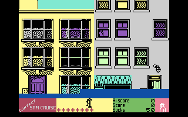

# Contact Sam Cruise for Commodore 64

A port of the 1986 ZX Spectrum adventure for a standard 64 KB Commodore 64. Both builds support PAL and NTSC.



## Play

Autostart the PRG or D64 from `build/` in VICE. On a C64, put the disk in drive 8, enter `LOAD"*",8,1` and wait for `READY.` Then enter `RUN`.

The launchers start the standard build in PAL mode. Add `stripes` for the other camera or `ntsc` for an NTSC machine.

```powershell
.\play.cmd
.\play.cmd stripes ntsc
```

```sh
sh play.sh
sh play.sh stripes ntsc
```

Press **Return** or joystick fire to start. Press **F1** to watch the demo and a letter to start a case from the demo. Sam starts in his office. Read the message about Lana at the Hotel Royale. The phone is in the room at the far left.

| Input | Action |
| --- | --- |
| **O**, **P** | Move left or right. Hold **Shift** to move faster. |
| **Q**, **A** | Move up or down. Hold **Shift** to move faster. |
| **Cursor Right**, **Cursor Down** | Move right or down. Hold **Shift** for left or up. Cursor keys use the faster steps. |
| **Joystick in port 2** | Move in four directions. Press fire to knock on or open a door. |
| **K** | Knock on or open a door. |
| **G**, **D** | Pick up an item or change disguise. |
| **T**, **0** to **9**, **H** | Pick up the phone with **T**, dial with the number keys and hang up with **H**. Use letter keys when asked for a name. |
| **L**, **B**, **F** | Use a light switch, a blind or a fuse. |
| **R**, **S**, **C** | Roll forward, somersault or use the hook. |
| **M** | Change the message speed. |
| **J** | Pause at `JOYSTICK?`. Press **K** for Kempston (joystick port 2) or **N** for keyboard only. Either choice resumes play. |

In VICE, use the arrow keys or assign your gamepad to joystick port 2.

### Camera variants

| Build | Camera |
| --- | --- |
| `contact-sam-cruise` | Smooth horizontal pans and short vertical cuts. [PAL recording](docs/camera-smooth-pal.png) |
| `contact-sam-cruise-stripes` | Vertical strips move across the view during horizontal pans. [PAL recording](docs/camera-stripes-pal.png) |

## Build

Install Python 3.10 or later, Git, cc65 and VICE. The build uses `ca65`, `od65`, `ld65` and `c1541`. Playing and testing in VICE use `x64sc`. Both builds were checked with cc65 2.19 and VICE 3.10.

If a tool is outside `PATH`, set its installation directory in the environment. The tools look in `bin` first and then in the installation directory itself. Paths can contain spaces.

| Installation directory | Executable overrides |
| --- | --- |
| `CC65_ROOT` | `CA65`, `OD65`, `LD65` |
| `VICE_ROOT` | `C1541`, `X64SC` |
| `GIT_ROOT` | `GIT` |

An executable override takes precedence over its installation directory. Set it to the full executable path. The build also accepts `--c1541 FILE` and the VICE tests accept `--vice FILE`.

If VICE is outside `PATH`, set its location in your shell. Replace the example value with your installation directory.

```powershell
$env:VICE_ROOT = '<VICE installation directory>'
```

```sh
export VICE_ROOT='<VICE installation directory>'
```

Run both builds from the project folder.

```powershell
python -m venv .venv
.\.venv\Scripts\python.exe -m pip install -r requirements.txt
.\.venv\Scripts\python.exe tools/build.py
.\.venv\Scripts\python.exe tools/build.py --stripe-camera
```

```sh
python3 -m venv .venv
.venv/bin/python -m pip install -r requirements.txt
.venv/bin/python tools/build.py
.venv/bin/python tools/build.py --stripe-camera
```

Each build writes a PRG, a D64 and matching VICE labels to `build/`. The build verifies the PRG against the copy on the D64 before replacing the output files.

The first build fetches the Spectrum disassembly into `.cache/contactsamcruise/`. The build uses revision `443910ecf2e8c31665690d6c4ceda89383635554` and checks the assembled image against a SHA-256 digest. For an offline build, install the Python dependencies and pass `--source FILE` with `sources/csc.skool` from that revision.

## Test

After building both variants, run these commands with the virtual environment's Python. The disk tests cover PAL and NTSC, the title and demo, and camera movement. Keep the matching `.lbl` beside each D64.

```sh
python tools/startup_test.py
python tools/vice_test.py --disk build/contact-sam-cruise.d64 --raster
python tools/vice_test.py --disk build/contact-sam-cruise-stripes.d64 --raster
```

## Credits and licensing

- Contact Sam Cruise © 1986 Microsphere Computer Services Ltd.
- Richard Dymond wrote the Spectrum disassembly. The annotations are under CC BY-SA 3.0 and the SkoolKit extension is under GPLv3. [Disassembly](https://github.com/skoolkid/contactsamcruise) [Licence notes](https://github.com/skoolkid/contactsamcruise/blob/443910ecf2e8c31665690d6c4ceda89383635554/sources/COPYING)
- SkoolKit assembles the Spectrum image and runs the Z80 reference in the tests. [SkoolKit](https://skoolkit.ca/)
- Ported to the Commodore 64 with Codex CLI and Claude Code. [Codex CLI](https://github.com/openai/codex) [Claude Code](https://github.com/anthropics/claude-code)

The generated PRG and D64 contain original game data and glyphs from the Spectrum ROM. Confirm redistribution rights before publishing the binaries.
